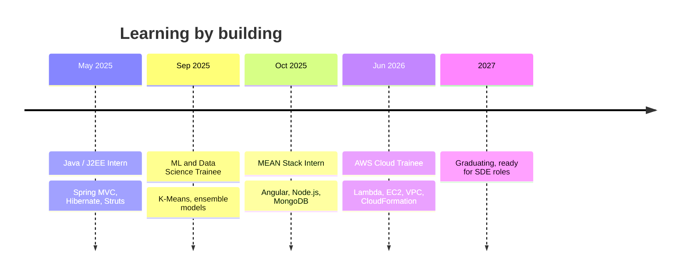

<div align="center">


<a href="https://git.io/typing-svg"></a>

<br/>

<a href="https://www.linkedin.com/in/chirag-jagtap"></a>
<a href="https://leetcode.com/u/0P6Omv7hB2/"></a>
<a href="https://www.instagram.com/_cj.27_/"></a>
<a href="https://github.com/CHIRAG-JAGTAP"></a>

<br/><br/>


</div>

---

## whoami

```java
public class Chirag {

    String role     = "Java Full-Stack Developer";
    String focus    = "Backend Engineering";
    String learning = "System Design, Cloud and DSA";
    String mantra   = "Fewer moving parts, fewer ways to fail.";

    String[] stack  = { "Java", "Spring MVC", "Hibernate", "Django", "Angular", "AWS" };

    boolean openToWork() {
        return true; // SDE roles, 2027 graduate
    }

    public static void main(String[] args) {
        while (alive) {
            learn();
            build();
            break();   // on purpose
            fix();
            repeat();
        }
    }
}
```

I build software by turning real-world problems into useful products. Four internships and trainings across **Java/J2EE, MEAN stack, Machine Learning and AWS** have taught me that good engineering is mostly about the details nobody notices.

---

## What drives me

<table>
  <tr>
    <td width="33%" align="center">
      <h2>01</h2>
      <b>Simplicity</b><br/>
      <sub>Fewer moving parts,<br/>fewer ways to fail.</sub>
    </td>
    <td width="33%" align="center">
      <h2>02</h2>
      <b>Product thinking</b><br/>
      <sub>Start with the person<br/>and the problem, not the stack.</sub>
    </td>
    <td width="33%" align="center">
      <h2>03</h2>
      <b>Systems</b><br/>
      <sub>I want to know how it works,<br/>and what happens when it breaks.</sub>
    </td>
  </tr>
  <tr>
    <td width="33%" align="center">
      <h2>04</h2>
      <b>Fundamentals</b><br/>
      <sub>OOP, DSA and clean architecture<br/>before any framework.</sub>
    </td>
    <td width="33%" align="center">
      <h2>05</h2>
      <b>Creative side</b><br/>
      <sub>Graphic design and<br/>leading a creative team.</sub>
    </td>
    <td width="33%" align="center">
      <h2>06</h2>
      <b>Hackathons</b><br/>
      <sub>Smart India Hackathon<br/>and GDGOC Hackathon.</sub>
    </td>
  </tr>
</table>

---

## Tech arsenal

<div align="center">

**Languages**<br/>


**Frameworks**<br/>


**Data and Cloud**<br/>


**Machine Learning**<br/>


</div>

---

## Things I've built

<table>
  <tr>
    <td width="50%" valign="top">
      <h3>Nutri Sync</h3>
      <sub><b>Hospital Management System</b></sub><br/><br/>
      Hospital workflow platform with a digital-menu module for patient nutrition.<br/><br/>
      
      
      
      
    </td>
    <td width="50%" valign="top">
      <h3>ValorPay</h3>
      <sub><b>J2EE Banking Portal</b></sub><br/><br/>
      Multi-tier banking app with secure MVC architecture, built for doorstep banking run by retired Army officers.<br/><br/>
      
      
      
    </td>
  </tr>
  <tr>
    <td width="50%" valign="top">
      <h3>EduTrack</h3>
      <sub><b>Smart Student Portal</b></sub><br/><br/>
      Academic dashboard with task management, performance tracking and AI-powered timetable analysis.<br/><br/>
      
      
      
    </td>
    <td width="50%" valign="top">
      <h3>Velle-Earning</h3>
      <sub><b>Student Job Platform</b></sub><br/><br/>
      Micro-job marketplace with dynamic listings, secure authentication and an admin dashboard.<br/><br/>
      
      
      
    </td>
  </tr>
</table>

Source code and demos are in the pinned repositories above.

---

## My journey so far



---

## Problem solving

<div align="center">

### Chirag Jagtap on LeetCode


<br/>

<a href="https://leetcode.com/u/0P6Omv7hB2/"></a>

</div>

---

## GitHub snapshot

<div align="center">
  
  
  <br/><br/>
  
</div>

---

## Thought of the moment

<div align="center">
  
</div>

---

## Let's connect

I'm looking for a **Software Development Engineer** role starting 2027. If you're building something backend-heavy and want someone who learns fast and owns what they ship, message me on [LinkedIn](https://www.linkedin.com/in/chirag-jagtap) or [Instagram](https://www.instagram.com/_cj.27_/).

<div align="center">

*Curious by default. Practical by design.*


</div>
